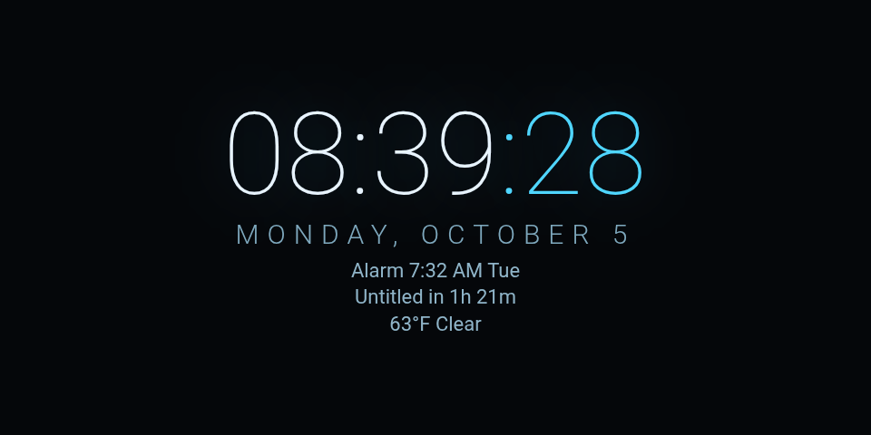
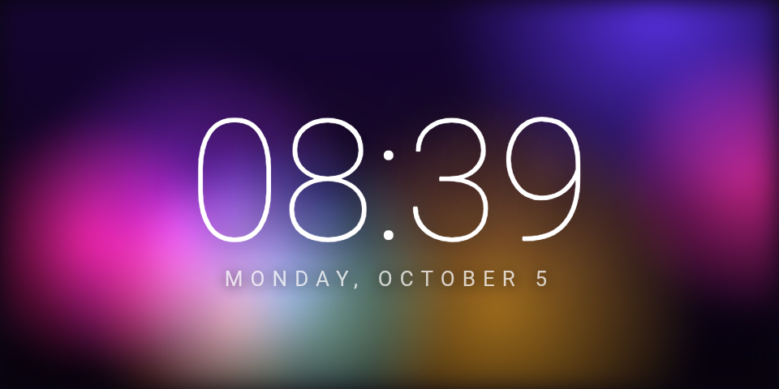
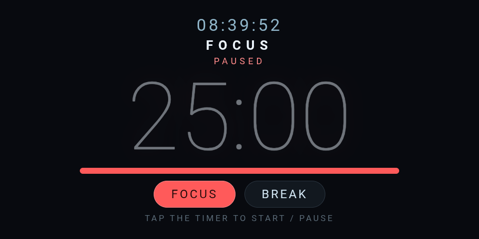
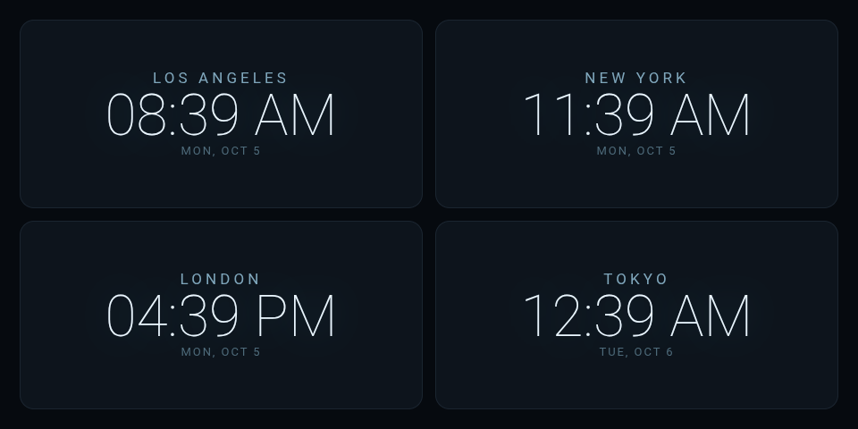
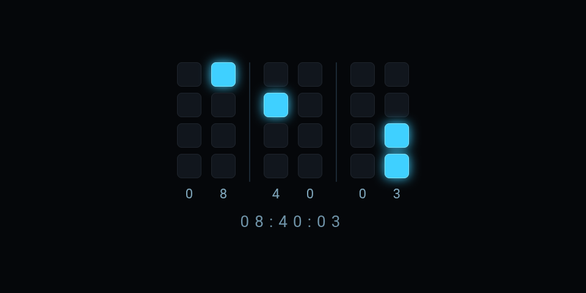
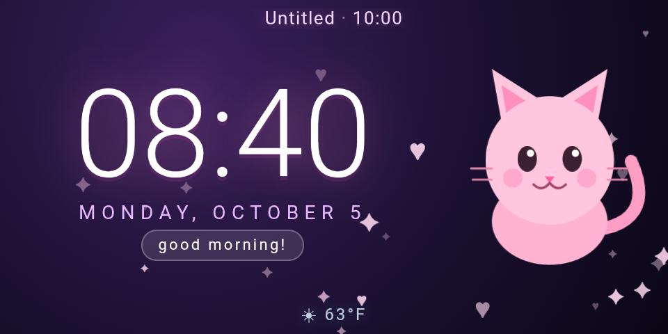
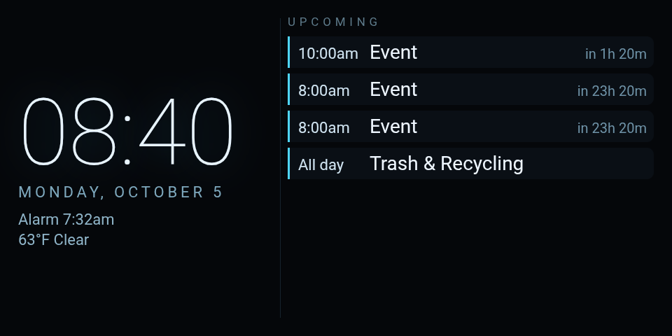

# EchoClock

Turn an **Amazon Echo Show 5 (2nd gen, 2021 — codename `cronos`)** into a private,
offline-first **desk clock launcher** on LineageOS 18.1 (Android 11): swipeable HTML/JS clock
faces with per-face settings, an app drawer, calendar events, alarms and local weather.
No account, no cloud — nothing leaves the device.

## Start here

| I want to… | Read |
|---|---|
| Install or flash an Echo Show 5 | **[install/README.md](install/README.md)** |
| Use the clock | [docs/USAGE.md](docs/USAGE.md) |
| Build or customize a clock face | [docs/CUSTOMIZE.md](docs/CUSTOMIZE.md) |
| Download the APK | [GitHub Releases](https://github.com/konsumer/echoclock/releases/latest) |

## What you get

- **Eleven bundled clock faces** — `agenda`, `analog`, `binary`, `cute`, `digital`, `flip`,
  `gallop`, `lava`, `pomodoro`, `world`, `arcade` — swiped left/right. A face is just an `index.html` +
  `face.json` directory, so you can write your own and drop it in
  ([faces/README.md](faces/README.md)).
- **Per-face settings** — long-press the clock; the native sheet is generated from the face's
  declared schema, checkboxes and all ([DESIGN §7.1](docs/DESIGN.md)).
- **An app drawer** — tap the clock for a scrollable grid of every installed app; **Home**
  returns to the clock.
- **On the clock today** — upcoming **calendar** events, the **next alarm** (hands off to the
  system Clock app) and local **weather** (open-meteo.com, no API key, cached on disk), plus a
  dedicated **`agenda`** face ([DESIGN §8](docs/DESIGN.md)).
- **Also a Bluetooth speaker** — the LineageOS port enables the A2DP sink, so you can pair a
  phone and play through the Echo's speaker while the clock keeps running
  ([docs/USAGE.md](docs/USAGE.md) → *Using it as a Bluetooth speaker*).
- **Seven external actions** — `face:<id>`, `app:<pkg>`, `nextFace`, `prevFace`, `openDrawer`,
  `weather:refresh`, `calendar:refresh` over adb, Tasker or Home Assistant
  ([DESIGN §7.3](docs/DESIGN.md)).

## Screenshots

All ten bundled faces, on a real Echo Show 5 (960×480) — calendar events, next alarm and local
weather all live.

| | | | | |
|---|---|---|---|---|
|  **gallop** |  **digital** |  **flip** |  **analog** |  **lava** |
|  **pomodoro** |  **world** |  **binary** |  **cute** |  **agenda** |

## Caveats

- **The camera works** once GApps is installed (open the app drawer → **Camera**).
- **SELinux is permissive** and the LineageOS port is **unofficial/experimental** — don't keep
  secrets on it.
- **Battery always reads 100%** and **deep sleep is disabled** — it's a wall-powered panel.
- Only the optional weather and any calendar account you sign in yourself use the network.

## Credits / prior art

- **LineageOS port** — bengris32, R0rt1z2, FieryFlames ([amazon-oss/releases](https://github.com/amazon-oss/releases)).
- **amonet** — R0rt1z2 ([github](https://github.com/R0rt1z2/amonet)); original BROM exploit lineage by xyz/k4y0z.
- **TWRP** for `cronos` — R0rt1z2 / amazon-oss.
- **Community playbooks** that informed the project — `dallanwagz/echo-show-jailbreak`,
  `revjmoney/oHce-checkmate-3ch0`, Derek Seaman's guide, DroidWin, and the XDA threads.

Not affiliated with Amazon, LineageOS, Google, or the tool authors. Use on hardware you own.

## License

[MIT](LICENSE) © 2026 David Konsumer.
